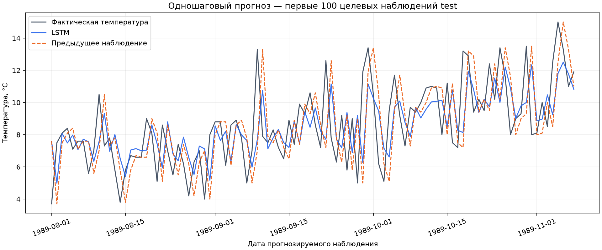

# LSTM Time Series

Учебный прогноз временного ряда на PyTorch. Модель получает **30 предыдущих температур** и предсказывает следующее наблюдение. Результат сравнивается с простым persistence baseline: прогноз равен последней известной температуре.

В проекте реализованы хронологическое разделение данных, нормализация по train, скользящие окна, обучение LSTM, сохранение лучших весов и оценка RMSE/MAE в градусах Цельсия.

## Данные и разбиение

Используются минимальные температуры в Мельбурне за 1981–1990 годы: **3650 наблюдений**, столбцы `Date` и `Temp`. Происхождение и команда получения CSV описаны в [data/README.md](data/README.md) и разделе запуска ниже.

Данные сортируются по дате и делятся без перемешивания:

| Часть | Наблюдения | Окна для оценки или обучения |
| --- | ---: | ---: |
| Train — 70% | 2555 | 2525 |
| Validation — 15% | 547 | 517 |
| Test — оставшаяся часть | 548 | 518 |

Среднее и стандартное отклонение рассчитываются **только по train** и затем применяются ко всем частям. Окна формируются отдельно внутри каждой выборки: первые 30 значений validation/test служат контекстом, а не целями прогноза. Порядок train-батчей перемешивается уже после такого разбиения.

Ряд почти ежедневный, но содержит два пропуска дат. Они не заполняются, поэтому точнее говорить о следующем **наблюдении**, а не безусловно о следующем календарном дне.

## Архитектура и обучение

```text
Окно [batch, 30, 1]
        ↓
Однослойная LSTM(input_size=1, hidden_size=128)
        ↓
Выход на последней позиции окна
        ↓
Linear(128, 1)
        ↓
Следующая нормализованная температура
```

Всего **67 201 обучаемый параметр**. Для получения градусов Цельсия применяется обратное преобразование `prediction * std + mean`.

| Настройка | Значение |
| --- | --- |
| Длина окна | 30 наблюдений |
| Batch size | 64 |
| Эпохи | 30 |
| Оптимизатор | AdamW |
| Learning rate | 0.001 |
| Loss | MSE на нормализованных значениях |
| Выбор весов | Минимальный validation loss |
| Устройство | CUDA, если доступна, иначе CPU |

## Результат сохранённой модели

21 ноября 2026 года пользовательский `check_point.pt` оценён без повторного обучения и подбора настроек. Обе модели сравнивались на одних и тех же целевых наблюдениях.

| Выборка | Метод | RMSE, °C | MAE, °C |
| --- | --- | ---: | ---: |
| Validation, 517 целей | LSTM | **2,2986** | **1,8314** |
| Validation, 517 целей | Предыдущее наблюдение | 2,6268 | 2,0112 |
| Test, 518 целей | LSTM | **2,2364** | **1,7405** |
| Test, 518 целей | Предыдущее наблюдение | 2,5953 | 2,0483 |

На этой отложенной части LSTM дала меньшую ошибку по обеим метрикам. RMSE сильнее реагирует на крупные ошибки; MAE — средняя абсолютная ошибка прогноза.



Это **пошаговая оценка на один шаг вперёд**: каждое окно содержит реальные предыдущие температуры, в том числе предыдущие наблюдения test. Предсказания модели не подставляются обратно в окно. Поэтому график не является прогнозом всех 518 точек сразу из одной начальной даты.

Test-цели в этой схеме охватывают период **с 1 августа 1989 по 31 декабря 1990 года**. Точные результаты, даты, версии библиотек и хеши находятся в [reports/metrics.json](reports/metrics.json).

В checkpoint сохранены параметры нормализации; они совпали с восстановленным train. Хеш корпуса, эпоха и индексы разбиения внутри checkpoint не записаны: происхождение весов предполагается по представленному коду. История использования test при разработке неизвестна; это проверка текущих весов, а не обещание нетронутого финального benchmark.

## Запуск на Windows

Проверенное окружение: Python 3.13.2, PyTorch 2.10.0+cu126, pandas 3.1.1, NumPy 2.5.4, Matplotlib 3.11.2.

```powershell
git clone https://github.com/Awuiga/lstm-time-series.git
cd lstm-time-series
py -3.13 -m venv .venv
.\.venv\Scripts\Activate.ps1
python -m pip install -r requirements.txt

New-Item -ItemType Directory -Force data | Out-Null
Invoke-WebRequest -Uri 'https://raw.githubusercontent.com/jbrownlee/Datasets/d20fcb6402ae34e653d4513b00f39257bb37ed7f/daily-min-temperatures.csv' -OutFile 'data/temperatures.csv'

python train.py
```

После обучения появится окно графика. **Закройте его, чтобы программа дошла до сохранения `check_point.pt`.** Далее:

```powershell
python predict.py
python evaluate.py
```

- **`train.py`** обучает модель, выбирает лучшие веса по validation loss и сохраняет их в `lstm_model.pt`. Затем считает test-метрики для LSTM и baseline, сохраняет `temperature_predictions.png`, показывает график и записывает полный `check_point.pt`.
- **`predict.py`** загружает полный checkpoint, берёт последние 30 температур CSV и печатает прогноз следующего наблюдения в °C. Будущее фактическое значение в файле отсутствует, поэтому проверить именно этот прогноз по исходному CSV нельзя.
- **`evaluate.py`** без переобучения восстанавливает выборки, проверяет mean/std, сравнивает LSTM с baseline и обновляет `reports/metrics.json` и `reports/predictions.png`. Пути доступны через `python evaluate.py --help`.

Готовые веса в Git не включены: после клонирования сначала нужно обучить модель. Новый запуск начинает обучение с нуля и перезаписывает локальные файлы весов и график; возобновление AdamW не реализовано. Загружайте только доверенные checkpoints. Для конкретной CUDA-сборки используйте [официальную страницу PyTorch](https://pytorch.org/get-started/locally/).

Для запуска обучения без открытия графического окна можно предварительно задать `$env:MPLBACKEND = 'Agg'`.

## Ограничения и воспроизводимость

- Seed обучения и перемешивания train-батчей не фиксирован. Новый запуск может дать другие веса и метрики, хотя хронологическое разбиение останется тем же.
- Это одномерный ряд одного места и периода. Модель не использует сезонные признаки, погоду в соседних точках или другие внешние данные. Перенос на другие годы и регионы не проверялся.
- Пропущенные даты не восстанавливаются; окно задано числом наблюдений. Проверка рекурсивного прогноза на несколько шагов не реализована.
- Цикл сохраняет лучшие веса, но не останавливается раньше 30 эпох. Значения train/validation loss считаются по всем объектам с учётом размера последнего батча.
- Логи исходного обучения не сохранены. График в README построен по оценке исходного checkpoint; история loss не восстанавливалась искусственно.

Исходная логика `train.py` и `predict.py` сохранена. Для публикации добавлен отдельный скрипт оценки и отчёт. Проверки описаны в [VERIFICATION.md](VERIFICATION.md). Датасет, веса, окружение и рабочие логи исключены из Git. Отдельная открытая лицензия на код пока не выбрана автором.
